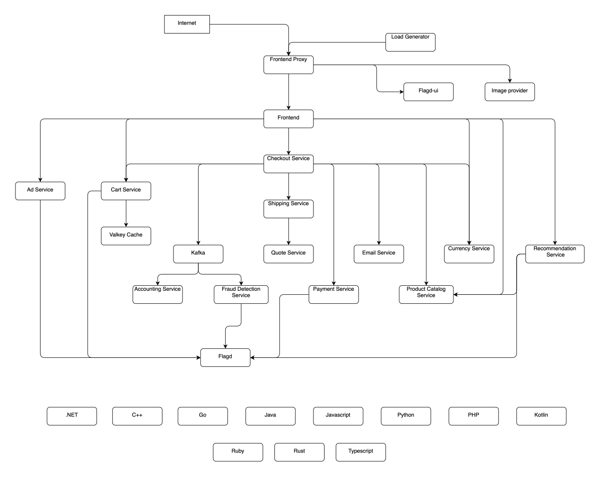

# E-Commerce DevOps Project - Source Code

This repository contains **source code** for the **e-commerce-devops-project** - OpenTelemetry Astronomy Shop, a microservice-based distributed system.

**Note:** This source code is is originally from [opentelemetry-demo](https://github.com/open-telemetry/opentelemetry-demo). Thanks to the team and contributors for opensourcing this wonderful demo project.

---

### Other Related Repositories

- Iac (terraform) repository for this project - [e-commerce-devops-project-iac](https://github.com/tharix46/e-commerce-devops-project-iac)
- Kubernetes repository for this project - [e-commerce-devops-project-k8s](https://github.com/tharix46/e-commerce-devops-project-k8s)

---

### Architecture

---
